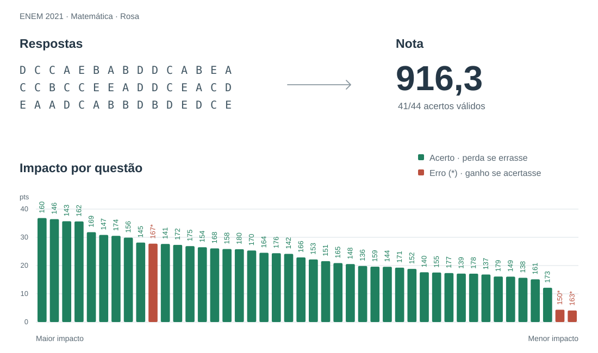
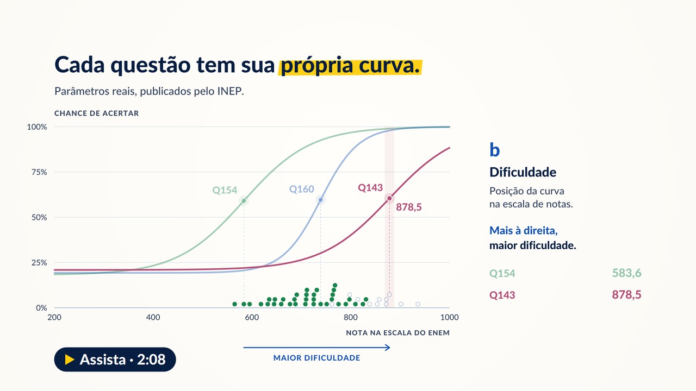
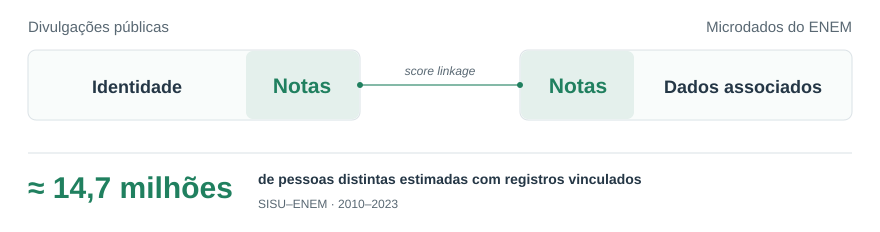

# Calculadora Nota TRI ENEM

Estime sua nota no ENEM (2009–2025) pela Teoria de Resposta ao Item, a partir das suas respostas.

**Usar no navegador: <a href="https://notatri.com/" target="_blank" rel="noopener noreferrer">notatri.com</a>** · <a href="#executar-localmente">Executar localmente</a> · <a href="docs/VALIDATION_REPORT.md" target="_blank" rel="noopener noreferrer">Provas disponíveis</a>

<p align="center">
<a href="relatorios/EXEMPLO_relatorio.pdf" target="_blank" rel="noopener noreferrer">
  <picture>
    <source media="(prefers-color-scheme: dark)" srcset="docs/imagens/exemplo-matematica-dark.svg">
    
  </picture>
</a>
<br>
<sub>Matemática, ENEM 2021 · <a href="relatorios/EXEMPLO_relatorio.pdf" target="_blank" rel="noopener noreferrer">ver relatório completo em PDF</a></sub>
</p>

- **Nota por área**, calculada com os parâmetros oficiais do INEP.
- **Impacto por questão:** quanto a nota mudaria ao acertar cada questão errada.
- **Relatório PDF** com gabarito visual e análise de acertos e erros.
- **Precisão conhecida:** cada prova é validada contra notas reais dos microdados.

## Executar localmente

Requer **Python 3.10+**. Os dados do cálculo já acompanham o projeto; não é
preciso baixar os microdados.

```bash
git clone https://github.com/HenriqueLindemann/analise-enem.git
cd analise-enem
python -m venv .venv
source .venv/bin/activate        # Windows: .venv\Scripts\Activate.ps1
python -m pip install -r requirements.txt
python meu_simulado.py
```

Para usar suas respostas, edite o início de <a href="meu_simulado.py" target="_blank" rel="noopener noreferrer"><code>meu_simulado.py</code></a>:

| Campo | Valor |
|-------|-------|
| `ANO`, `TIPO_APLICACAO` | Ano e aplicação da prova |
| `COR_*` | Cor do caderno de cada área |
| `RESPOSTAS_*` | 45 letras (`A`–`E`) na ordem da prova; `.` para branco; `''` para pular a área |
| `LINGUA` | `'ingles'` ou `'espanhol'`; em LC, inclua só as questões do idioma escolhido |

O relatório é salvo em `relatorios/`. Com `GERAR_PDF = False`, a nota aparece
apenas no terminal.

## Uso como biblioteca

```bash
python -m pip install -e .
```

```python
from tri_enem import SimuladorNota

resultado = SimuladorNota().calcular(
    area='MT',
    ano=2021,
    respostas='DCCAEBABDDCABEACCBCCEEADDCEACDEAADCABBDBDEDCE',
    cor_prova='rosa',
    tipo_aplicacao='1a_aplicacao',
)
print(f'Nota estimada: {resultado.nota:.1f}')
```

Mais na <a href="src/tri_enem/README.md" target="_blank" rel="noopener noreferrer">documentação da API</a> e nos <a href="examples/README.md" target="_blank" rel="noopener noreferrer">exemplos</a>.

## Método e validação

A nota é calculada com os parâmetros dos itens publicados pelo INEP e conferida
contra as notas oficiais dos microdados. A escala de cada prova é a de menor
erro médio; provas com poucos resultados para conferência são marcadas como
estimativa. Detalhes no <a href="docs/SCORE_RECALCULATION.md" target="_blank" rel="noopener noreferrer">método de cálculo</a> e nas
<a href="docs/VALIDATION_REPORT.md" target="_blank" rel="noopener noreferrer">métricas por prova</a>.

<p align="center">
<a href="streamlit_app/assets/video-nota-tri.mp4" target="_blank" rel="noopener noreferrer">
  
</a>
<br>
<sub>Como a nota TRI é calculada, em 2 minutos · <a href="https://notatri.com/?video=1" target="_blank" rel="noopener noreferrer">assistir no site</a></sub>
</p>

## Desenvolvimento

```bash
python -m pip install -e ".[web,dev]"
python -m pytest
```

| Documento | Conteúdo |
|-----------|----------|
| <a href="relatorios/README.md" target="_blank" rel="noopener noreferrer">Relatórios</a> | Conteúdo e interpretação dos PDFs |
| <a href="streamlit_app/README.md" target="_blank" rel="noopener noreferrer">Interface web</a> | Execução e estrutura do app |
| <a href="tests/README.md" target="_blank" rel="noopener noreferrer">Testes</a> | Testes automatizados e validação com microdados |
| <a href="tools/README.md" target="_blank" rel="noopener noreferrer">Ferramentas</a> | Preparação dos dados e recalibração |
| <a href="CONTRIBUTING.md" target="_blank" rel="noopener noreferrer">Contribuição</a> | Como sugerir melhorias e relatar problemas |

## Autor e licença

Desenvolvido por **Henrique Lindemann** (Engenharia de Computação, UFRGS) ·
<a href="https://www.linkedin.com/in/henriquelindemann/" target="_blank" rel="noopener noreferrer">LinkedIn</a>.
Licença <a href="LICENSE" target="_blank" rel="noopener noreferrer">PolyForm Noncommercial 1.0.0</a> (uso não comercial).

**Trabalho relacionado:** <a href="https://doi.org/10.1016/j.cose.2026.105080" target="_blank" rel="noopener noreferrer">Knowing millions of students too well</a>,
sobre privacidade nos microdados do ENEM (*Computers & Security*, 2026).

<p align="center">
<a href="https://doi.org/10.1016/j.cose.2026.105080" target="_blank" rel="noopener noreferrer">
  <picture>
    <source media="(prefers-color-scheme: dark)" srcset="docs/imagens/artigo-score-linkage-dark.svg">
    
  </picture>
</a>
</p>
